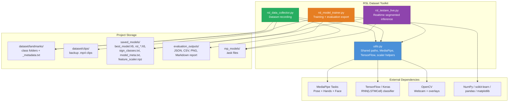
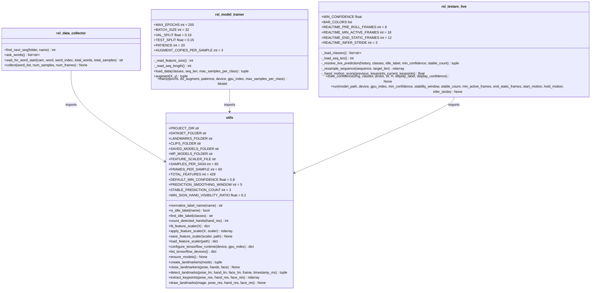
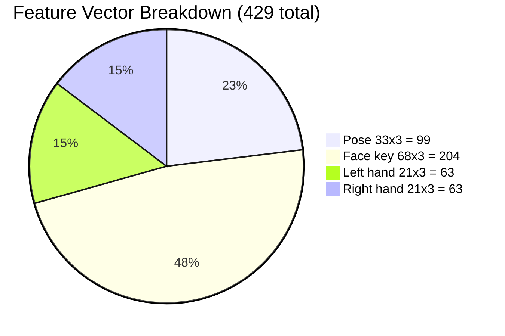
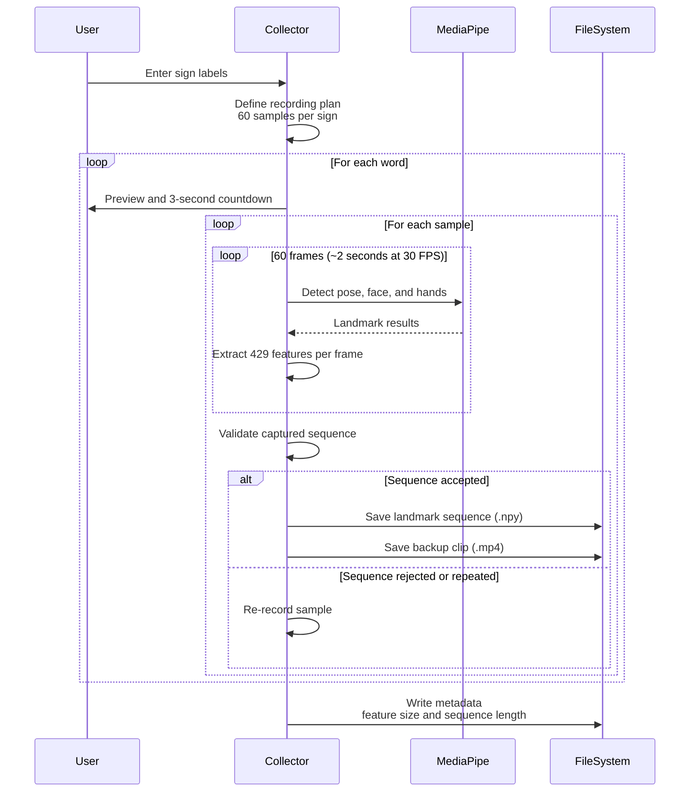
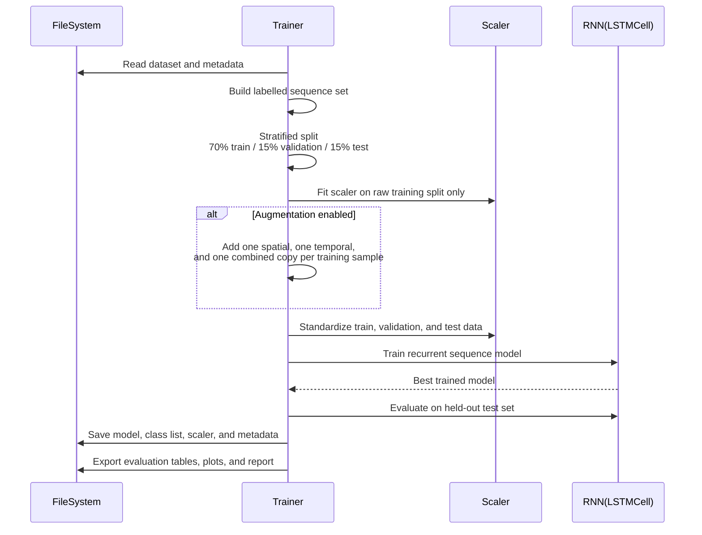
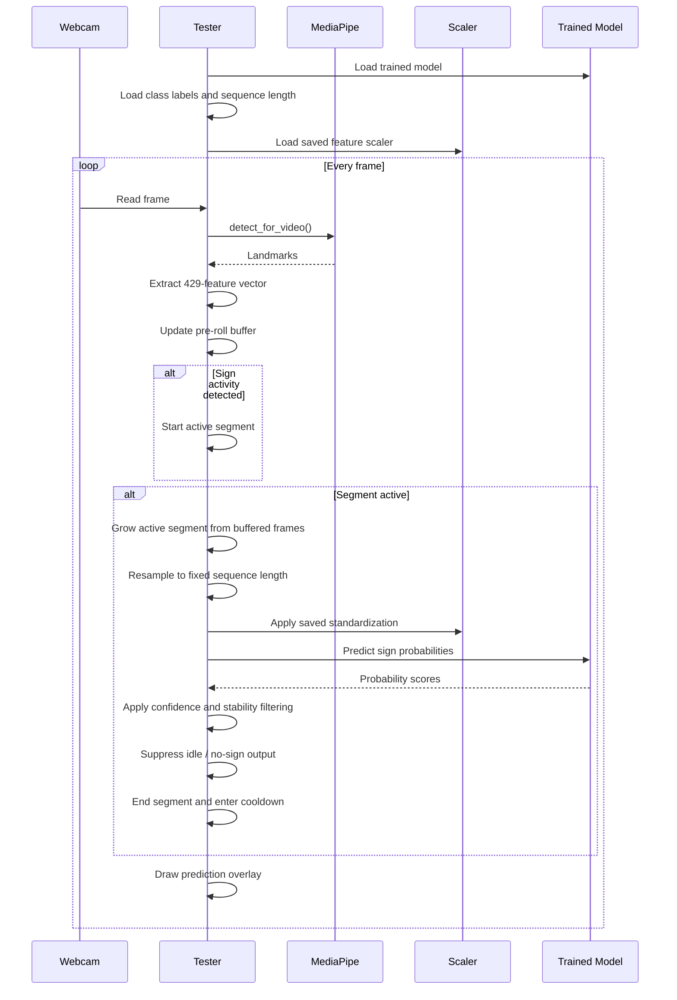
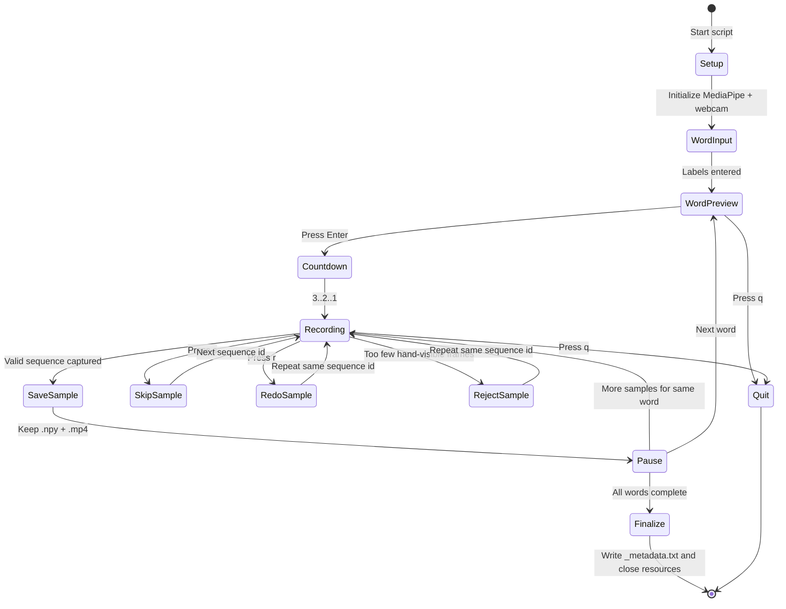
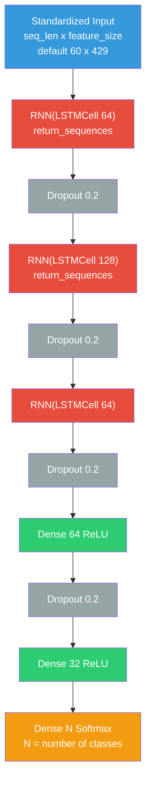

# Mermaid Diagram Sources

All diagram source code for the RSL Dataset Toolkit documentation.
Run `python render_diagrams.py` to regenerate the JPEG images.

---

## 01 — Architecture Overview

---

## 02 — System Pipeline

```mermaid
flowchart LR
    A["Webcam frame stream"] --> B["MediaPipe VIDEO mode<br/>pose + hands + face"]
    B --> C["Extract 429 landmark features<br/>33 pose + 68 face + 21 + 21 hands"]
    C --> D["Collector saves<br/>.npy sequence + .mp4 clip + metadata"]
    D --> E["Trainer loads class folders<br/>and reads seq_len / feature size"]
    E --> F["Stratified split<br/>train / val / held-out test"]
    F --> G["Optional train-only augmentation<br/>spatial + temporal + combined"]
    G --> H["Fit feature scaler on raw train split"]
    H --> I["Standardize train / val / test"]
    I --> J["Train RNN(LSTMCell) stack<br/>checkpoint + early stop + LR reduction"]
    J --> K["Save model artifacts<br/>model, classes, scaler, metadata"]
    J --> L["Export evaluation outputs<br/>metrics, report, plots, confusion matrix"]
    K --> M["Live webcam inference"]
    M --> N["Motion-gated active segment detection<br/>pre-roll + hand visibility"]
    N --> O["Resample segment to fixed length<br/>then apply saved scaler"]
    O --> P["Predict class probabilities"]
    P --> Q["Stability filter + idle suppression<br/>confidence bars + label overlay"]

    style A fill:#2ecc71,color:#fff
    style B fill:#3498db,color:#fff
    style C fill:#3498db,color:#fff
    style D fill:#f39c12,color:#fff
    style E fill:#e67e22,color:#fff
    style F fill:#e67e22,color:#fff
    style G fill:#e67e22,color:#fff
    style H fill:#e67e22,color:#fff
    style I fill:#e67e22,color:#fff
    style J fill:#e74c3c,color:#fff
    style K fill:#f39c12,color:#fff
    style L fill:#f39c12,color:#fff
    style M fill:#9b59b6,color:#fff
    style N fill:#9b59b6,color:#fff
    style O fill:#9b59b6,color:#fff
    style P fill:#9b59b6,color:#fff
    style Q fill:#9b59b6,color:#fff
```

---

## 03 — Class Diagram

---

## 04 — Feature Vector Breakdown

---

## 05 — Data Collection Sequence

---

## 06 — Training Sequence

---

## 07 — Live Test Sequence

---

## 08 — Collector State Machine

---

## 09 — Model Architecture

