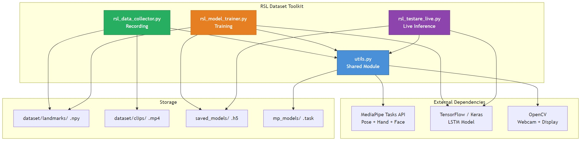
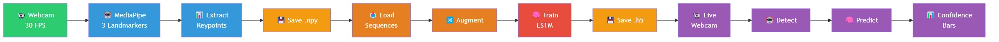
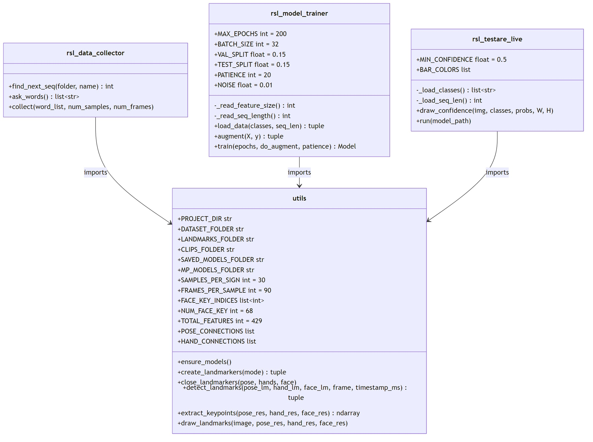
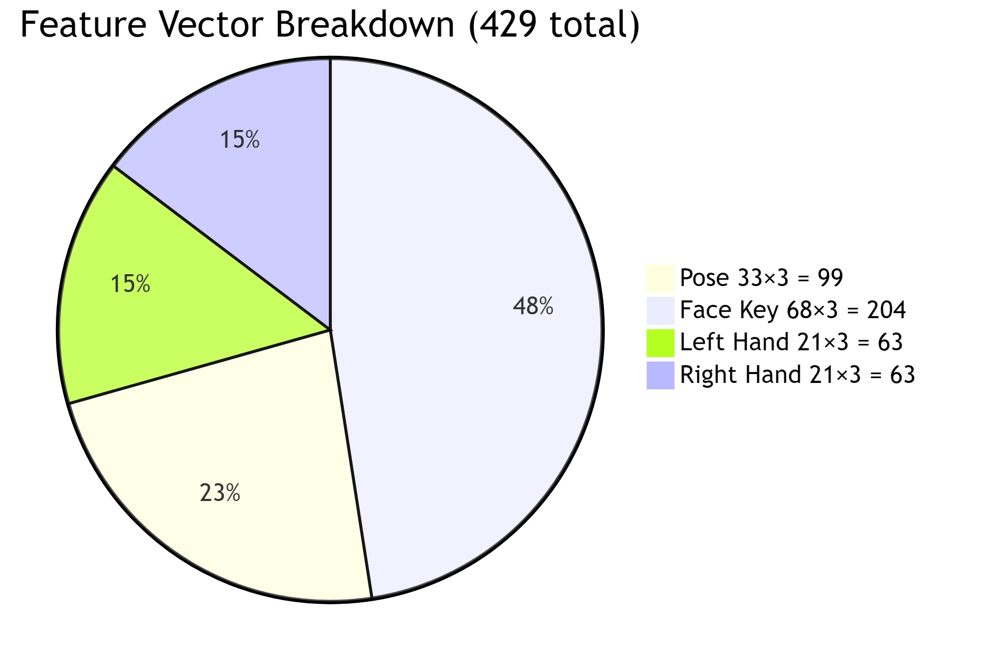
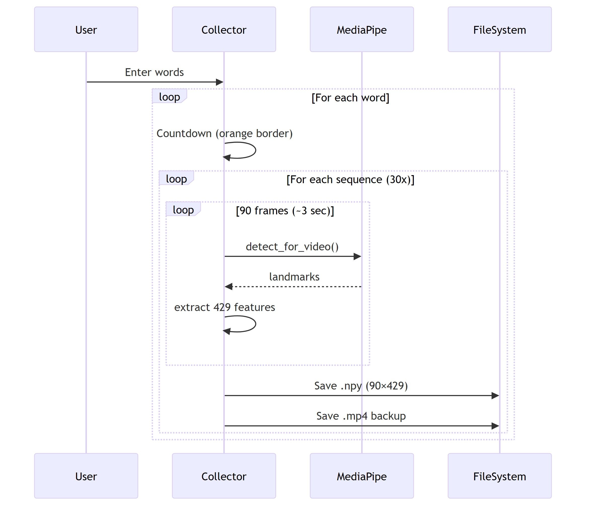
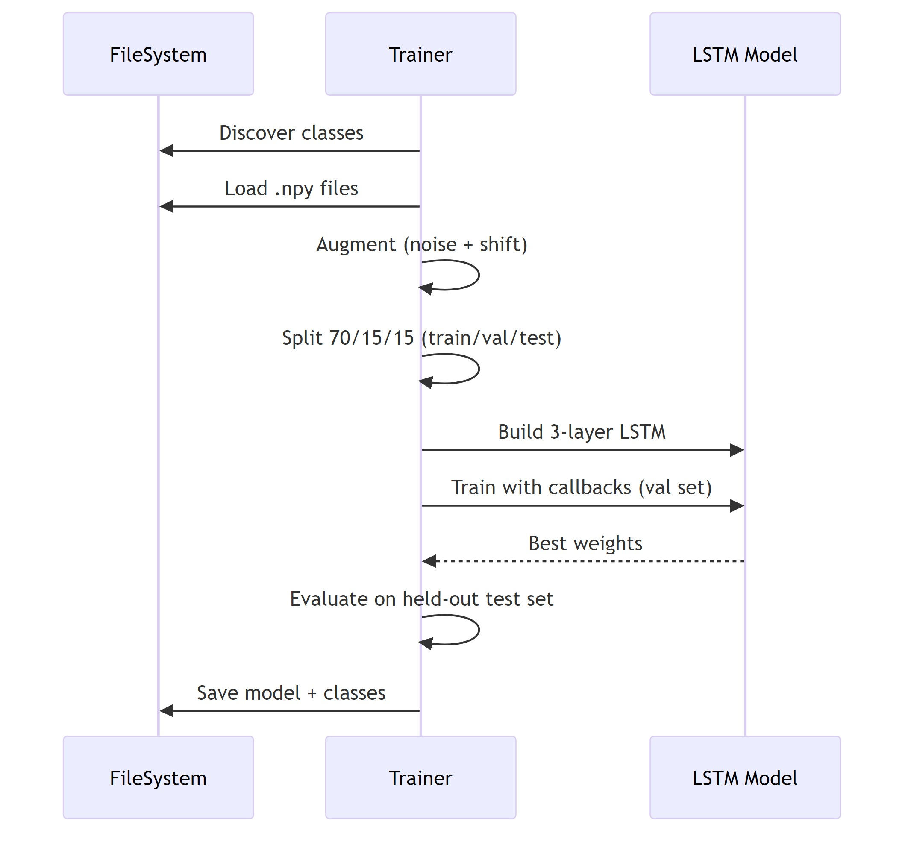
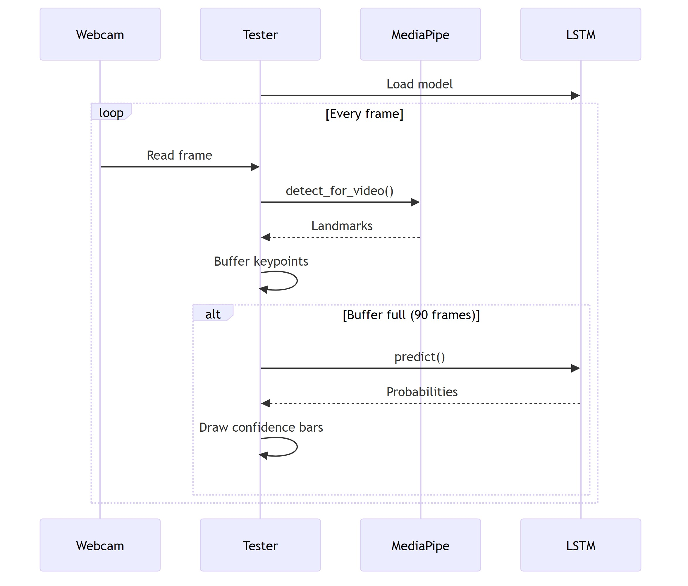
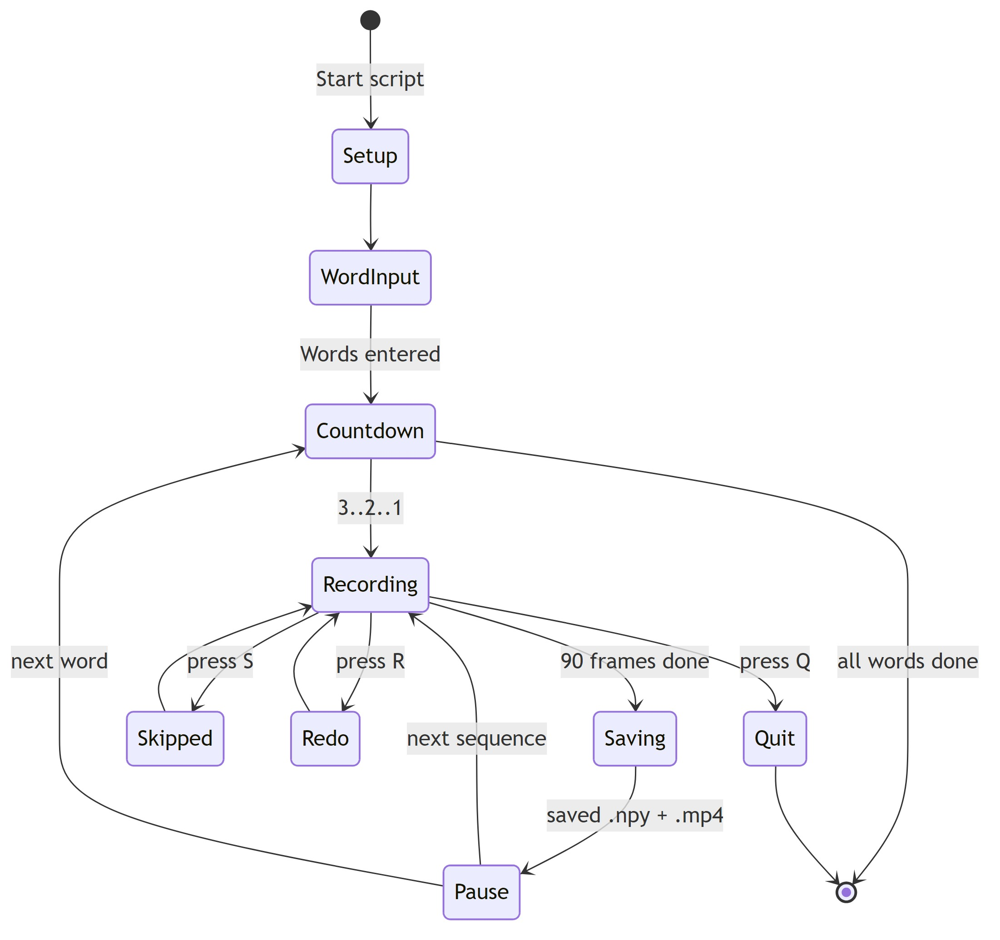
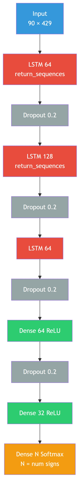

# RSL Dataset Toolkit — Documentation

> **Romanian Sign Language** dataset recording, model training, and real-time inference pipeline.
> Built with MediaPipe Tasks API (0.10.30+), TensorFlow/Keras LSTM, and OpenCV.

---

## Table of Contents

1. [Architecture Overview](#architecture-overview)
2. [System Pipeline](#system-pipeline)
3. [File Structure](#file-structure)
4. [Module Descriptions](#module-descriptions)
5. [Feature Vector Design](#feature-vector-design)
6. [Data Flow](#data-flow)
7. [State Machine — Data Collector](#state-machine--data-collector)
8. [Model Architecture](#model-architecture)
9. [Usage Guide](#usage-guide)
10. [Configuration](#configuration)

---

## Architecture Overview



---

## System Pipeline



**Three phases:**

| Phase | Script | Input | Output |
|-------|--------|-------|--------|
| **1. Collect** | `rsl_data_collector.py` | Webcam + user words | `.npy` keypoints + `.mp4` clips |
| **2. Train** | `rsl_model_trainer.py` | `.npy` keypoints | `.h5` LSTM model |
| **3. Test** | `rsl_testare_live.py` | Webcam + `.h5` model | Real-time predictions |

---

## File Structure

```
RSLdataset/
├── utils.py                    # Shared module (constants, MediaPipe, extraction, drawing)
├── rsl_data_collector.py       # Data collection script
├── rsl_model_trainer.py        # Model training script
├── rsl_testare_live.py         # Live inference script
├── requirements.txt            # Python dependencies
│
├── docs/                       # Documentation and diagrams
│   ├── DOCUMENTATION.md        # This file
│   └── *.jpg                   # Rendered diagram images
│
├── mp_models/                  # Auto-downloaded MediaPipe models
│   ├── pose_landmarker.task
│   ├── hand_landmarker.task
│   └── face_landmarker.task
│
├── dataset/                    # Collected data
│   ├── landmarks/              # Recorded keypoint data
│   │   ├── _metadata.txt       # features count, frames count
│   │   ├── hello/
│   │   │   ├── hello_1.npy     # shape: (90, 429)
│   │   │   ├── hello_2.npy
│   │   │   └── ...
│   │   └── thanks/
│   │       ├── thanks_1.npy
│   │       └── ...
│   │
│   ├── clips/                  # Raw video backups
│   │   ├── hello/
│   │   │   ├── hello_1.mp4
│   │   │   └── ...
│   │   └── thanks/
│   │       └── ...
│
├── saved_models/               # Trained models
│   ├── best_model.h5           # Best checkpoint
│   ├── rsl_YYYYMMDD_HHMM.h5   # Timestamped final
│   ├── sign_classes.txt        # Class names
│   └── model_meta.txt          # Feature/sequence info
│
```

---

## Module Descriptions

### `utils.py` — Shared Module



All three scripts import from `utils.py` — **zero duplicated code**.

---

## Feature Vector Design



### Comparison with Full Mesh

| Approach | Face Points | Feature Vector | Reduction |
|----------|------------|----------------|-----------|
| Full MediaPipe Holistic (old) | 468 | **1662** | — |
| **This project (key points)** | **68** | **429** | **74%** |

### Key Face Landmarks (68 points)

| Region | Count | Purpose |
|--------|-------|---------|
| Face outline | 17 | Face shape, head tilt |
| Eyes | 12 | Eye gaze, blinks |
| Eyebrows | 10 | Brow raise (questions, emphasis) |
| Nose | 9 | Face orientation reference |
| Lips | 20 | Mouth shape (mouthing, expressions) |

> **Why keep face?** In sign language, facial expressions carry grammatical meaning — raised eyebrows = question, furrowed brows = negation, mouth shapes = adverbs.

---

## Data Flow

### Data Collection



### Model Training



### Live Inference



---

## State Machine — Data Collector



**Visual indicators during recording:**
- 🟧 **Orange border** — Countdown, get ready
- 🟩 **Green border + 🔴 REC** — Recording in progress
- 🟦 **Blue border** — Sequence saved, brief pause

---

## Model Architecture



### Training Callbacks

| Callback | Monitor | Action |
|----------|---------|--------|
| `ModelCheckpoint` | `val_loss` | Save best weights to `best_model.h5` |
| `EarlyStopping` | `val_loss` | Stop after 20 epochs without improvement |
| `ReduceLROnPlateau` | `val_loss` | Halve learning rate after 10 stale epochs |

### Data Augmentation (optional `--augment`)

| Method | Description |
|--------|-------------|
| Gaussian noise | Add N(0, 0.01) noise to all keypoints |
| Time-shift | Roll sequence by 1 frame forward |

---

## Usage Guide

### Prerequisites

```bash
cd <project-root>
python -m venv .venv
.\.venv\Scripts\activate       # Windows
cd RSLdataset
pip install -r requirements.txt
```

### Step 1 — Collect Data

```bash
python rsl_data_collector.py
# Or with custom settings:
python rsl_data_collector.py --samples 40 --frames 90
```

**Controls:** `q` = quit, `s` = skip sequence, `r` = redo sequence

### Step 2 — Train Model

```bash
python rsl_model_trainer.py
# With augmentation and more epochs:
python rsl_model_trainer.py --epochs 300 --augment --patience 30
```

### Step 3 — Live Test

```bash
python rsl_testare_live.py
# Or with specific model:
python rsl_testare_live.py --model saved_models/rsl_20260215_0300.h5
```

---

## Configuration

All settings are centralized in `utils.py`:

| Constant | Default | Description |
|----------|---------|-------------|
| `SAMPLES_PER_SIGN` | 30 | Sequences recorded per gesture |
| `FRAMES_PER_SAMPLE` | 90 | Frames per sequence (~3s at 30fps) |
| `DETECTION_THRESHOLD` | 0.5 | MediaPipe detection confidence |
| `TRACKING_THRESHOLD` | 0.5 | MediaPipe tracking confidence |
| `TOTAL_FEATURES` | 429 | Keypoint features per frame |
| `NUM_FACE_KEY` | 68 | Key face landmarks tracked |

### Trainer-specific (`rsl_model_trainer.py`)

| Constant | Default | Description |
|----------|---------|-------------|
| `MAX_EPOCHS` | 200 | Maximum training epochs |
| `BATCH_SIZE` | 32 | Training batch size |
| `TEST_SPLIT` | 0.15 | Test data ratio |
| `PATIENCE` | 20 | Early stopping patience |
| `NOISE` | 0.01 | Augmentation noise level |

---

## Technology Stack

| Component | Technology | Version |
|-----------|-----------|---------|
| Landmark Detection | MediaPipe Tasks API | 0.10.30+ |
| Deep Learning | TensorFlow / Keras | 2.x |
| Computer Vision | OpenCV | 4.x |
| Data Processing | NumPy | 1.x |
| Model Evaluation | scikit-learn | 1.x |
| Language | Python | 3.13 |

---

*Iurie Virlan — RSL Dataset Toolkit — 2026*
